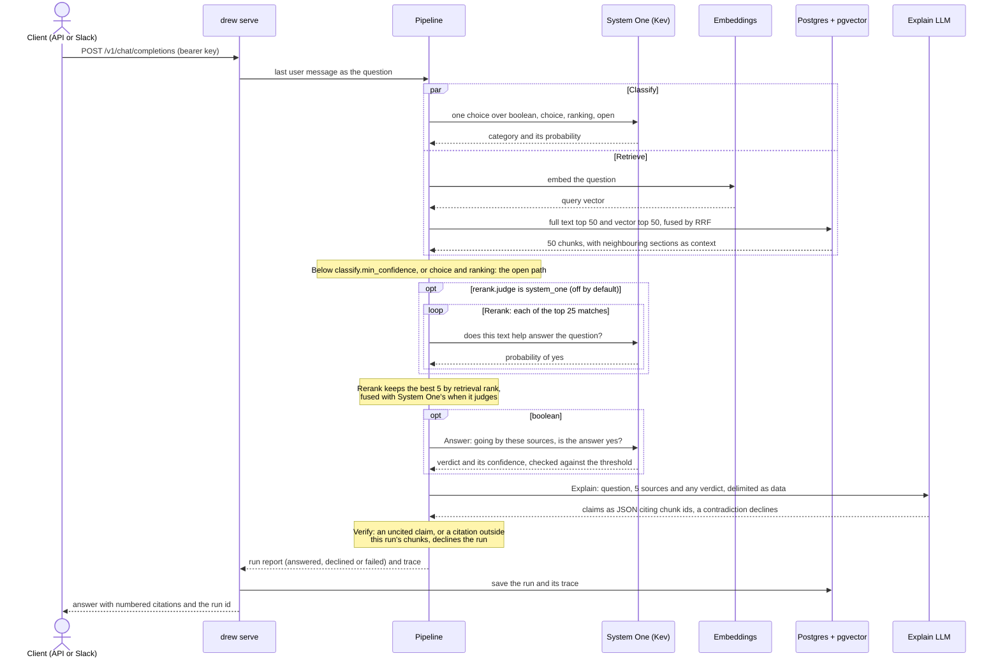

# Drew AI

Drew AI answers questions about SAP and ARM internals from **Drew Steinfatt's pre-audited markdown documentation**. Every answer cites its sources; when the sources don't support an answer, it declines instead of guessing.

It ships as a **developer-facing Slack bot** (Socket Mode, in `drew serve`) and an **OpenAI-compatible HTTP API**.

- [Design](docs/design.md): scope, pipeline model, evaluation, and milestones.
- [Architecture diagram](docs/archify/architecture.html): open it in a browser.

## Status

What works today:

- Batch ingestion of a markdown directory into Postgres with pgvector.
- Hybrid retrieval (full text + vectors, reciprocal rank fusion).
- Classify and Answer on a System One model ([Kev](https://github.com/jaredpalmer/kev)), with calibrated confidence scores; Rerank on it too when `rerank.judge` says so.
- The `open` path end to end: retrieve, rerank, explain with an LLM, verify every citation.
- OpenAI-compatible HTTP API, run persistence with full traces (trace on `GET /v1/runs/{id}`, not in chat responses).
- Optional Slack bot when `SLACK_APP_TOKEN` and `SLACK_BOT_TOKEN` are set.
- `drew eval` and local or Bedrock models.

Yes/no questions get a verdict: Kev answers yes or no over the reranked sources, the LLM explains why, and the run declines when the sources contradict the verdict or Kev is not confident enough. A classification below `classify.min_confidence` falls back to `open`.

Not built yet: Answer for `choice` and `ranking` (they take the `open` path); permission enforcement.

## How a question is answered

```
Classify ∥ Retrieve → Rerank → Explain → Verify
```



Each step is typed, so a pipeline with steps in the wrong order does not compile. Verify rejects any claim without a citation, or citing a chunk the run did not retrieve. Every run, including declines and failures, is stored with a trace of each step's model, prompt version, score, and raw output.

## Latest evaluation

The benchmark is the DaaS golden set (`eval/golden/daas.jsonl`, 58 questions), run on 2026-10-19 at `e35960e` with local models: `bge-m3` embeddings, Kev 4B for System One (Classify, Rerank, Answer) and `qwen3:14b` for Explain. Config: [`config/drew.json`](config/drew.json). Full runs, traces and setup: [`eval/results/daas-2026-10-19-v3.json`](eval/results/daas-2026-10-19-v3.json). Gate later runs against it with `--baseline`.

| Scope | Runs | Classify | Recall@50 | Hit@5 | Precision | Declined | Failed | Citations valid |
|---|---|---|---|---|---|---|---|---|
| Overall | 58 | 93.1% | 78.4% | 70.7% | 71.4% | 17.2% | 0.0% | 100.0% |
| Boolean | 15 | 93.3% | 56.7% | 46.7% | 83.3% | 60.0% | 0.0% | 100.0% |
| Choice | 1 | 100.0% | 100.0% | 100.0% | 0.0% | 0.0% | 0.0% | 100.0% |
| Open | 42 | 92.9% | 85.7% | 78.6% | - | 2.4% | 0.0% | 100.0% |

Every yes/no verdict Kev gave was right (5 of 5); precision also counts Q50, which was classified `open` and so has no verdict, and the choice question, which takes the `open` path until `Answer<Choice>` exists. Most yes/no questions decline at the Answer threshold (0.7) because Kev 4B's probability of yes sits between 0.3 and 0.7 on them. The first run of the day, before the Answer step and the fused Rerank, scored hit@5 36% and classification 83% ([`daas-2026-10-19.json`](eval/results/daas-2026-10-19.json)).

## Running locally

Requires Docker and Rust (the toolchain is pinned in `rust-toolchain.toml`; `rustup` installs it).

```sh
docker compose up -d --wait db     # Postgres + pgvector on localhost:5433
cp .env.example .env               # then fill it in, see Configuration
set -a; source .env; set +a

export DREW_DOCS_DIR=/path/to/drew-markdown   # your audited corpus
cargo run -- ingest
cargo run -- serve                 # API on DREW_BIND; Slack bot if tokens are set
```

Ask a question:

```sh
curl -s localhost:8080/v1/chat/completions \
  -H "Authorization: Bearer sk-local-drew" \
  -H "Content-Type: application/json" \
  -d '{"model": "drew-ai", "messages": [{"role": "user", "content": "What does AGR_USERS store?"}]}'
```

The answer is in `choices[0].message.content`. The top-level `drew` object carries the run id, outcome, and citations. Use `GET /v1/runs/{id}` for the full trace (admins listed in `DREW_ADMIN_USERS` can read any run).

### Slack app setup

1. Create a Slack app with **Socket Mode** enabled.
2. App-level token with `connections:write` → `SLACK_APP_TOKEN` (`xapp-…`).
3. Bot token scopes: `app_mentions:read`, `chat:write`, `im:history`.
4. Subscribe to bot events: `app_mention`, `message.im`.
5. Enable the App Home **Messages** tab for DMs.
6. Set `SLACK_BOT_TOKEN` (`xoxb-…`) and restart `drew serve`.

The bot replies in threads on `@mentions` and in DMs. Runs are stored as user `slack:{slack_user_id}`.

### Running fully locally

`.env.example` is set up for local models; nothing calls AWS.

- **Embeddings and Explain: [Ollama](https://ollama.com).** Embeddings must have 1024 dimensions.

  ```sh
  brew install ollama && brew services start ollama
  ollama pull bge-m3
  ollama pull qwen3:14b
  ```

- **System One (Classify): [Kev](https://github.com/jaredpalmer/kev)** on Apple Silicon via MLX.

Switching embedding models requires `drew ingest --reembed`.

## Commands

| Command | What it does |
|---|---|
| `drew serve` | OpenAI API plus optional Slack bot |
| `drew ingest` | Snapshot ingest from `DREW_DOCS_DIR`; `--reembed` after changing the embedding model |
| `drew eval run …` / `drew eval tune …` | Golden-set metrics and threshold tuning. `eval/golden/daas.jsonl` holds DaaS's own golden questions (`_ops/EVAL.md`, held out of the corpus): `drew eval run --golden eval/golden/daas.jsonl --out eval/results/daas.json --concurrency 2`. `--question daas-q13` (repeatable, or comma-separated) runs only those questions; with `--baseline`, the baseline is compared on the same questions |
| `cargo eval-misses` | The eight DaaS questions whose relevant chunks retrieval missed at `4ebe407`, compared against that run (`eval/results/daas-2026-10-21-v4.json`). Run it before the full golden set when changing retrieval. Output goes to `eval/results/retrieval-misses.json` (gitignored); extra `--question` ids are appended to the set |
| `drew eval retrieval …` / `cargo eval-retrieval` | Runs only Retrieve (embedder and database; no System One, no LLM) on the golden set and prints recall@10 and recall@50 per question and per category. Recall counts matches only, not the neighbouring sections added as context. `--baseline` takes an `eval run` or `eval retrieval` results file and lists each question as gained, lost or unchanged; a lost question exits non-zero. The alias runs all DaaS questions against `eval/results/daas-retrieval-2026-10-22-bm25.json` (retrieval at `6752079`, with BM25: recall@10 68.1%, recall@50 86.2%; before BM25, `daas-retrieval-2026-10-22.json`: 61.2% and 79.3%), not the v4 full run that `cargo eval-misses` uses, since v4 predates `context_for` and counts context chunks; it writes `eval/results/retrieval.json` (gitignored) |

## Configuration

Tunables (retrieval, the Classify fallback, Rerank, step thresholds) are in [`config/drew.json`](config/drew.json), or the file `DREW_CONFIG` names; unknown keys are rejected. `drew eval run` prints the config and models at the start (through `jq` when installed) and records them in the results file; `models.rerank` names the model that judged Rerank, or is `null` when none did.

`rerank.judge` chooses who judges Rerank's matches, independent of Classify and Answer, which use System One whenever it is configured:

- `"none"` (the default and the shipped setting): matches keep retrieval order, with evidence ranked `evidence_rank_penalty` places lower; no model call, and no Rerank threshold applies.
- `{"system_one": {"candidates": 25}}`: System One judges the best 25 matches by fused score, as before. `candidates` lives inside the variant because it means nothing without a judge, and must be at least `top_k`.

On the 2026-10-22 DaaS run (`eval/results/daas-2026-10-22-v5.json`) System One reranking cost about 40 s and 25 System One calls per question for hit@5 43/58 against 41/58 in retrieval order, and was worse on yes/no questions (7/15 against 10/15), so it is off.

See `.env.example`. Key variables: `DATABASE_URL`, `DREW_API_KEYS`, `DREW_ADMIN_USERS`, `DREW_DOCS_DIR`, `DREW_DOCS_BASE_URL`, `DREW_DOCS_AUTHORITATIVE` / `DREW_DOCS_EVIDENCE` / `DREW_DOCS_SKIP` (which paths are Drew's answers, which are supporting evidence, and which are left out), model URLs, `SLACK_APP_TOKEN`, `SLACK_BOT_TOKEN`.

## Code layout

| Path | Contents |
|---|---|
| `src/ingest/markdown.rs` | Markdown directory source and heading-section chunking |
| `src/slack/` | Socket Mode bot, Slack API client, mrkdwn rendering |
| `src/pipeline/` | Typed pipeline and steps |
| `src/server/` | OpenAI-compatible HTTP API |
| `migrations/` | Postgres schema |

## Development

With the database running:

```sh
cargo fmt --check
cargo clippy --all-targets -- -D warnings
cargo nextest run        # brew install cargo-nextest, or cargo install cargo-nextest --locked
cargo test --doc         # nextest does not run doctests; the compile_fail ones guard the pipeline types
```

Conventions are in [AGENTS.md](AGENTS.md).
